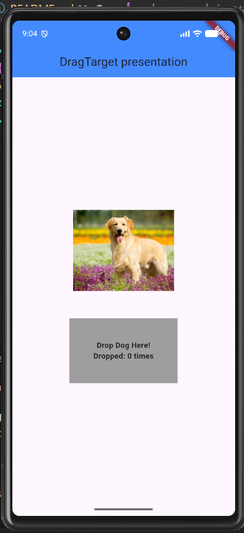
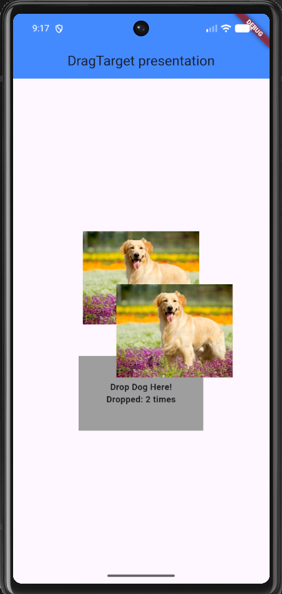

# DragTarget

## Description

it is a widget that allow user to drop certain dragged items into targeted area by showing the visual representation of the target

## Simple run instruction

### Make sure that you have futter installed in your laptop
1. clone repository: git clone https://github.com/inezakevin23/drag_target.git
2. navigate into project folder: cd drag_target
3. run the application: flutter run

## 3 core attributes

1. builder:  A function that returns the visual representation of the target.
2. onWillAccept / onWillAcceptWithDetails:  A callback that decides whether to accept the incoming data type before the drop happens.
3. onAccept / onAcceptWithDetails : A callback that executes when a compatible Draggable is dropped onto the target, allowing you to update your app state

## Final UI screenshot

